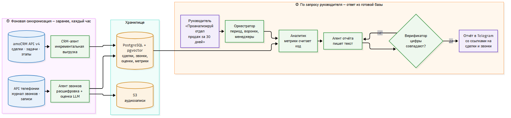
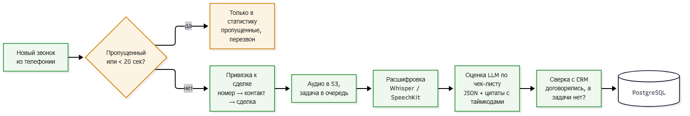

Здравствуйте! Спасибо за задание, было интересно. Ниже ответы по всем четырём пунктам.

---

## 1. Архитектура

Главное, на чём я бы строил систему: не собирать данные в момент запроса. Если на фразу «проанализируй отдел продаж за 30 дней» начать выгружать всё из amoCRM и расшифровывать сотни звонков, руководитель будет ждать ответа часами. Поэтому данные из CRM и телефонии синхронизируются заранее, раз в час и по вебхукам. Звонки расшифровываются по мере поступления. На запрос руководителя система отвечает уже из своей базы.



**Какие агенты нужны и откуда берут данные**

- **Оркестратор.** LLM с вызовом инструментов. Разбирает свободный запрос: какой период, все ли воронки, весь ли отдел. Если запрос однозначный, сразу строит план, если нет — уточняет у руководителя.
- **CRM-агент.** Работает через amoCRM API v4 по OAuth и только на чтение. Берёт:
  - сделки — `/api/v4/leads`;
  - задачи — `/api/v4/tasks`;
  - историю смены этапов — `/api/v4/events`, из неё считаются конверсия и время на этапе;
  - примечания о звонках — `/api/v4/leads/notes`;
  - справочники менеджеров и воронок.

  У API есть лимит 7 запросов в секунду, поэтому запросы идут через очередь с повтором при ошибке 429. Выгрузка инкрементальная, по полю `updated_at`.
- **Агент звонков.** Берёт журнал звонков и записи напрямую из API телефонии: Mango, UIS, Sipuni и т.п., в зависимости от того, что стоит в CityCar. Именно там видны пропущенные звонки и разговоры, которые не попали в CRM.
- **Аналитик.** Считает все цифры кодом (SQL, pandas), а не языковой моделью:
  - конверсию по этапам и по каждому менеджеру;
  - скорость первого контакта с новым лидом;
  - сделки без задач и с просроченными задачами;
  - пропущенные звонки, на которые не перезвонили;
  - количество и среднюю оценку звонков, частые возражения;
  - всё то же в сравнении с предыдущими 30 днями.
- **Агент отчёта.** Получает готовые цифры и примеры и пишет по ним человеческий текст: короткое резюме, таблицу по менеджерам, три главные проблемы со ссылками на конкретные сделки и звонки и рекомендации. Отдельный проверяющий шаг смотрит, чтобы каждая цифра в тексте совпадала с рассчитанной. Если цифра «придумана», текст переписывается.

**Как обрабатываются звонки**



1. Пропущенные звонки сразу идут в статистику. Разговоры короче ~20 секунд и автоответчики отсеиваются.
2. Звонок привязывается к сделке по номеру телефона: номер → контакт в amoCRM → сделка, которая была открыта в момент звонка.
3. Запись скачивается в хранилище и встаёт в очередь (Celery + Redis). Каждый звонок обрабатывается ровно один раз.
4. Расшифровка: Whisper на своём сервере или Yandex SpeechKit. Менеджер и клиент разделяются по стерео-каналам, если АТС пишет так.
5. LLM оценивает разговор по чек-листу отдела продаж: приветствие, выявление потребности, работа с возражениями, договорённость о следующем шаге. Ответ — в строгом JSON, к каждому выводу прикладывается цитата с таймкодом.
6. Результат сверяется с CRM. Например: в звонке договорились «созвонимся в пятницу», а задачи в amoCRM нет. Такие находки, на мой взгляд, самые полезные для руководителя.

**Где хранятся результаты**

- **PostgreSQL** — сделки, задачи, звонки, расшифровки, оценки, посчитанные метрики и сами отчёты. Через pgvector можно искать по смыслу разговоров («покажи звонки, где спорили о цене»).
- **S3-хранилище** (Yandex Object Storage или MinIO) — аудио с ограниченным сроком хранения.
- **Каналы для руководителя** — отчёт приходит в Telegram или на почту, постоянные метрики выводятся на дашборд в DataLens.

Стек: Python, FastAPI, Celery + Redis, PostgreSQL + pgvector, Docker.

---

## 2. Что система делает сама, а что отдаёт человеку

**Сама:**
- собирает данные, привязывает звонки к сделкам;
- считает метрики и сравнивает их с прошлым периодом;
- расшифровывает и оценивает звонки;
- находит проблемные места: сделки без задач, просрочки, пропущенные без перезвона, сделки, «зависшие» на этапе;
- готовит отчёт с рекомендациями.

**Отдаёт человеку:**
- **Выводы о людях.** Премии, штрафы, «менеджер работает плохо» решает руководитель. Система показывает факты и ссылки на них, но не выносит вердиктов сотрудникам.
- **Любые действия в CRM и с клиентами.** Поставить задачу, сменить ответственного, написать клиенту — система готовит черновик, человек подтверждает его одним нажатием.
- **Спорные случаи.** Плохая запись, звонок не привязался к сделке, модель не уверена в оценке, данные противоречат друг другу.
- **Критерии оценки.** Чек-лист утверждает руководитель отдела продаж. Он же раз в неделю просматривает 5–10% оценок, чтобы проверить, что модель оценивает так же, как оценил бы он.

**Три главных риска**

1. **Данные хуже, чем кажется.** Если CRM ведётся формально, часть звонков идёт с личных телефонов, а переписка — в мессенджерах, отчёт будет точным ровно настолько, насколько полны данные. Поэтому в каждом отчёте я бы честно показывал покрытие, например «к сделкам привязано 83% звонков». При низком покрытии система не должна делать выводов о конкретном менеджере.
2. **Ошибки распознавания и выдуманные выводы.** Шум, марки и модели авто, цифры распознаются с ошибками, а LLM иногда «додумывает». Защита:
   - цифры считает только код;
   - модель отвечает по жёсткой схеме;
   - у каждого вывода есть цитата с таймкодом, которую можно открыть и послушать;
   - часть оценок регулярно проверяет человек.
3. **Персональные данные (152-ФЗ).** Записи разговоров, телефоны и имена клиентов — чувствительные данные. Отправлять их как есть в зарубежные AI-сервисы нельзя. Я бы обрабатывал их в российском облаке или на своём сервере, маскировал телефоны и ФИО перед отправкой в LLM, давал интеграции с CRM права только на чтение и ограничил срок хранения записей.

Отдельно учёл бы объём. 10 менеджеров по 40 звонков в день за месяц — это около 9 000 звонков и сотни часов аудио. Поэтому звонки обрабатываются каждый день понемногу, а не разом по запросу.

---

## 3. Код

Python, amoCRM API v4. Вместо запроса на каждую сделку скрипт делает две массовые выгрузки:
1. все невыполненные задачи по сделкам, из них — самый ранний срок для каждой сделки;
2. все сделки.

Закрытые (этапы 142 и 143) и удалённые сделки пропускаются. У остальных проверяется, есть ли открытая задача и не просрочена ли она. Скрипт учитывает постраничную выдачу по 250 записей, пустой ответ 204 и лимит 7 запросов в секунду.

```python
"""Активные сделки amoCRM без открытых задач или с просроченными задачами (API v4)."""
import os
import time

import requests

BASE = os.environ["AMO_BASE_URL"].rstrip("/") + "/api/v4"  # https://citycar.amocrm.ru
S = requests.Session()
S.headers["Authorization"] = f"Bearer {os.environ['AMO_TOKEN']}"  # долгосрочный токен / OAuth
CLOSED = {142, 143}  # системные этапы «Успешно реализовано» и «Закрыто и не реализовано»


def fetch_all(path, params=None):
    """Постранично выгружает сущности; пустой список amoCRM отдаёт как 204 No Content."""
    page = 1
    while True:
        r = S.get(f"{BASE}/{path}", params={**(params or {}), "page": page, "limit": 250}, timeout=30)
        if r.status_code == 204:
            return
        r.raise_for_status()
        data = r.json()
        yield from data.get("_embedded", {}).get(path, [])
        if "next" not in data.get("_links", {}):
            return
        page += 1
        time.sleep(0.15)  # лимит API — 7 запросов в секунду


def problem_leads():
    now = int(time.time())
    deadlines = {}  # lead_id -> самый ранний срок среди невыполненных задач
    for t in fetch_all("tasks", {"filter[is_completed]": 0, "filter[entity_type]": "leads"}):
        deadlines[t["entity_id"]] = min(t["complete_till"], deadlines.get(t["entity_id"], t["complete_till"]))
    for lead in fetch_all("leads"):
        if lead["status_id"] in CLOSED or lead.get("is_deleted"):
            continue
        due = deadlines.get(lead["id"])
        if due is None:
            yield {**lead, "problem": "no_tasks", "overdue_days": None}
        elif due < now:
            yield {**lead, "problem": "overdue", "overdue_days": (now - due) // 86400}


if __name__ == "__main__":
    for lead in problem_leads():
        extra = f", просрочка {lead['overdue_days']} дн." if lead["overdue_days"] is not None else ""
        print(f"#{lead['id']} «{lead['name']}» отв. {lead['responsible_user_id']}: {lead['problem']}{extra}")
```

С amoCRM в продакшене я пока не работал. Код написан по официальной документации API и проверен на тестовых ответах: две страницы задач, пустая страница, закрытые сделки, сделка с одной просроченной и одной будущей задачей.

Для боевого режима я бы добавил:
- автообновление OAuth-токена;
- повторы запроса при ошибках;
- фильтр по воронке и менеджеру;
- запись результата в базу вместо вывода в консоль.

---

## 4. Мой AI-проект

**Neuro World Bot** — github.com/Artemfuture/neuro-world-bot

**Задача.** Сделать один Telegram-бот, через который можно пользоваться несколькими нейросетями, не переключаясь между сайтами и подписками.

**Что я сделал.**
- Подключил в одном интерфейсе пять AI-сервисов: три текстовые модели (OpenAI GPT, YandexGPT, GigaChat) и две модели генерации изображений (Kandinsky, YandexART).
- Добавил колоризацию чёрно-белых фотографий.
- Пользователь выбирает модель, бот запоминает его настройки.

**Стек.** Python, aiogram (асинхронно), сценарии диалога на FSM, PostgreSQL + SQLAlchemy, Docker Compose.

**Результат.** Бот работает и стабильно ходит в пять внешних API. Главный вывод из проекта: сама модель — меньшая часть работы. Больше всего времени ушло на инженерию вокруг неё:
- у каждого сервиса свой формат запросов и ответов;
- внешние API иногда падают и возвращают ошибки, и всё это нужно валидировать и обрабатывать, чтобы бот не «ломался» у пользователя;
- секреты нужно держать отдельно от кода.

Эта задача ближе всего к вашей: собрать данные из нескольких систем, надёжно с ними работать и выдать человеку понятный результат.

Ещё один релевантный опыт — **ITCamp НИТУ МИСИС, 3 место (август 2026)**. Там я спроектировал AI-пайплайн обработки алертов мониторинга: Zabbix и Prometheus → нормализация → привязка к CMDB → классификация → маршрутизация ответственному. Он учит тому же, что и ваша задача: AI полезен только тогда, когда данные из разных источников уже приведены к единому виду и связаны между собой.

---

Готов обсудить любой пункт подробнее.

Артём Неронов
Telegram: @artemneronov · GitHub: github.com/Artemfuture
